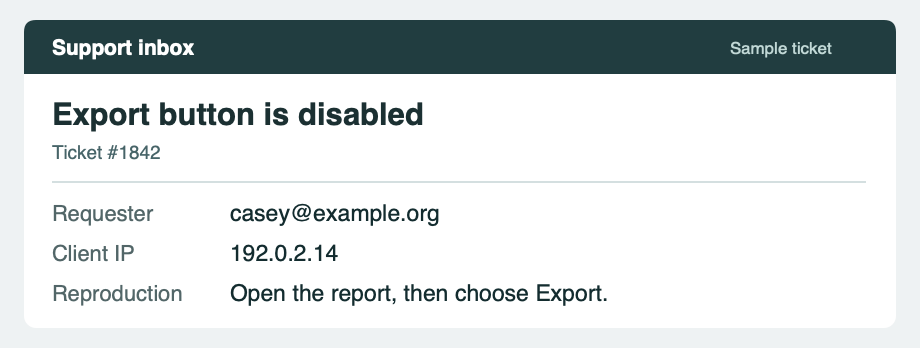
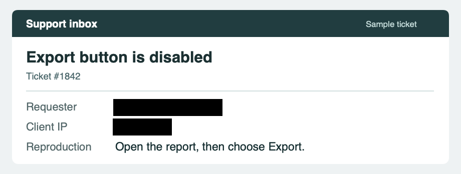

# Redaktr

Redaktr is a macOS app that helps you remove sensitive details from screenshots before you attach them to a support ticket, paste them into a chat, or publish a bug report. You review the suggested regions, draw any missing ones, and copy or save a flattened image with opaque masks.

**Redaktr uses Apple’s built-in Vision models and processes images entirely on your Mac.** It works offline and requires no external AI service, API key, account, or separate model download. The source build requires macOS 14 or later and Xcode with its macOS SDK.

[](https://github.com/davidahma/redaktr/actions/workflows/ci.yml)

| Original sample | Reviewed PNG from RedaktrCore |
| --- | --- |
| [](docs/fixtures/support-ticket.png) | [](docs/fixtures/support-ticket-cleaned.png) |

## Build and open the app

Run these commands in Terminal on your Mac. The build uses local ad hoc signing and requires no Apple Developer team or signing certificate.

```sh
git clone https://github.com/davidahma/redaktr.git
cd redaktr
xcodebuild -project Apps/macOSApp/Redaktr/Redaktr.xcodeproj \
  -scheme Redaktr -configuration Debug -destination 'platform=macOS' \
  -derivedDataPath build/community \
  CODE_SIGN_STYLE=Manual DEVELOPMENT_TEAM= CODE_SIGN_IDENTITY=- build
open build/community/Build/Products/Debug/Redaktr.app
```

If the app asks to move to Applications, choose **Not Now** to try your local build in place. The checked-in Xcode project and Swift package contain the app and its dependencies. See the [migration guide](docs/product/migration.md) if you have an older direct-sale build.

## Try a support ticket

The sample ticket contains a fictional requester email and a documentation-only IP address. In Redaktr, press **⌘O** and choose [support-ticket.png](docs/fixtures/support-ticket.png) from your checkout.

1. Choose **Scan** if the image hasn't already been scanned. Review the suggestions for the email and IP address.
2. Mark those two values for redaction. If either was missed, use **Manual → Draw** to cover it. Leave the ticket number and reproduction steps visible.
3. Preview the output and inspect it at full size. Use **Copy** to put a PNG on the clipboard or **Export cleaned copy** to save a new image. Open the result to check that a support engineer can still read the problem.

## What you can use it for

- Open, paste, or drop a screenshot. Supported file types include PNG, JPEG, TIFF, and HEIC.
- Review possible emails, credential-like strings, account identifiers, payment card numbers, faces, QR codes, and barcodes. Add your own local terms, patterns, and exceptions in Settings.
- Adjust the proposed masks and add boxes by hand. Export a flattened PNG or JPEG. The encoder creates a fresh image without copying the original file's metadata.
- For repeated work, review a folder as a batch, or opt into watching a screenshot folder or image clipboard. Screen capture is optional and may require macOS Screen Recording permission.

## How on-device redaction works

1. **Read and locate.** Redaktr calls the Apple Vision framework built into macOS. `VNRecognizeTextRequest` reads screenshot text in accuracy mode and provides the bounding boxes used to place masks. `VNDetectFaceRectanglesRequest` locates faces, and `VNDetectBarcodesRequest` locates QR codes and other barcodes.
2. **Flag and review.** Swift rules scan the recognized text for patterns such as email addresses, payment card numbers, and credential-like strings. Redaktr applies your custom terms, regular expressions, and allowlist locally, then maps matches back to the image for review.
3. **Render and export.** Core Graphics draws opaque masks into a fresh bitmap. Image I/O encodes that bitmap as PNG or JPEG without copying metadata from the source file. Clipboard output is a flattened PNG.

Screenshot pixels and recognized text stay on the Mac throughout this pipeline. The community app has no network entitlements, telemetry, trial, license key, or in-app updater. [Apple Vision documentation](https://developer.apple.com/documentation/vision) · [Redaktr architecture](docs/engineering/architecture.md)

## Before sharing

The output only covers the regions you select. Small text, low contrast, unfamiliar formats, and sensitive details that depend on context can all escape detection. A scan with zero suggestions still needs a human review. Inspect the exported copy and attach that file. The source image may still contain the original information, and other apps may keep their own copies or clipboard history.

## Development

```sh
swift test --package-path Packages/RedaktrCore
```

For the full UI suite, run this on a Mac with Xcode and an interactive desktop session.

```sh
REDAKTR_UI_SUITE=full Scripts/test_ui.sh
```

The [Swift package](Packages/RedaktrCore) contains OCR, detector rules, policy, geometry, and rendering. The [macOS app](Apps/macOSApp/Redaktr) contains the editor and the capture, clipboard, and file workflows.

- [Contribute a fix or a synthetic detector case](CONTRIBUTING.md)
- [Understand the detector tests and their limits](docs/product/detector-quality-scorecard.md)
- [Evaluate Redaktr with a support team](docs/product/evaluation.md)
- [Read the architecture](docs/engineering/architecture.md) and [threat model](docs/engineering/threat-model.md)
- [Release a verified build](docs/engineering/releasing.md)
- [Report a security or privacy issue privately](SECURITY.md)
- [Read the changes](CHANGELOG.md) or [check how releases are built and verified](docs/engineering/releasing.md)

Redaktr is licensed under [Apache-2.0](LICENSE).
