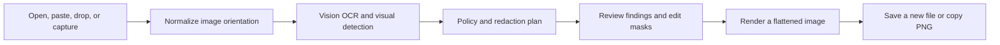

# Architecture

Redaktr runs as a sandboxed SwiftUI app on macOS. The app handles file selection, pasteboard access, capture, notifications, and review. The local [RedaktrCore package](../../Packages/RedaktrCore) handles image normalization, detector rules, redaction plans, and encoding. Apple Vision supplies OCR, face rectangles, and barcode observations.

## Review and export

Each image has a scan state. Completed scans can enter the output flow with their current masks. If detection fails, the image stays in review until the user retries or explicitly reviews it manually. Batch output uses a staging directory and publishes the finished directory only after every selected image is written. Single-image export compares the destination with the source before any write. Batch import admits up to 128 files and 64 million total source pixels before decoding. Split larger jobs into smaller batches.

The renderer applies opaque masks to a fresh bitmap and encodes it without carrying over the input file's metadata. Review is still necessary because detector confidence describes the findings Redaktr saw. It cannot account for sensitive regions the detectors missed.

## Optional automatic output

Capture can save or copy, and Clipboard Protection can replace an image on the pasteboard. Capture opens review by default. Clipboard Protection starts disabled. When you enable it, the default mode pauses for findings marked Check and can replace an image when no finding requires review. When the user enables automatic clipboard replacement, the result is tied to the pasteboard generation that Redaktr scanned. Undo also checks ownership before changing a later pasteboard or generated file.

## Local state

Settings and recent output history live in the app container. Policy files can include literal terms, regular expressions, and exceptions, so review them before sharing. The app ships with sandbox and user-selected file access entitlements. GitHub help links open in the system browser when selected.

## Test boundaries

The [detector scorecard](../product/detector-quality-scorecard.md) covers known rules. Raster fixtures exercise Vision, output masking, and preservation of control regions. UI tests use the `UITesting` build configuration, a separate bundle identifier, and a named pasteboard. Release builds omit test-only fixture and failure hooks.
